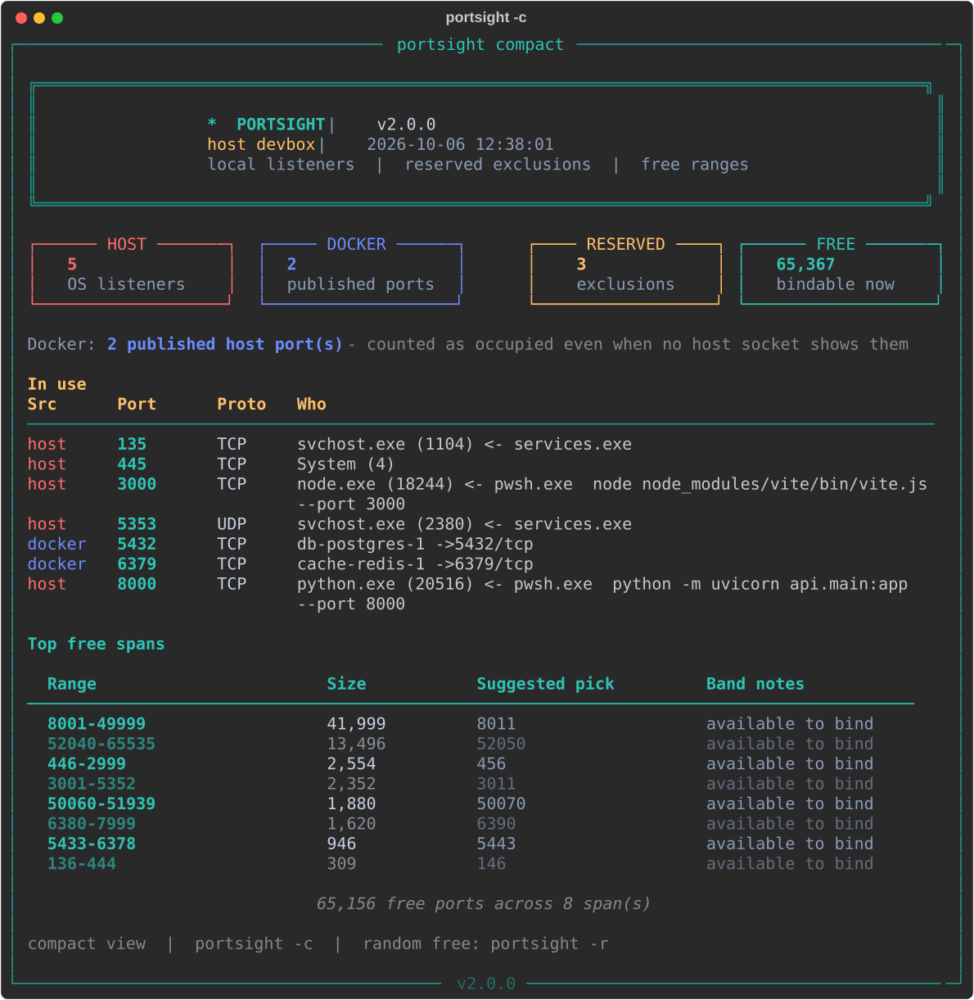
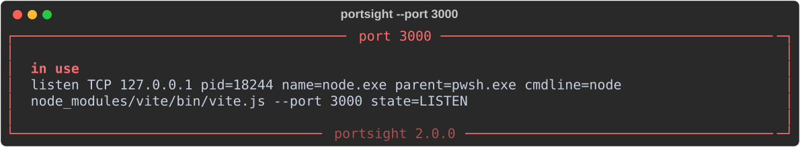

# portsight

[](https://github.com/rfdpro/portsight/actions/workflows/ci.yml)
[](https://pypi.org/project/portsight/)
[](https://pypi.org/project/portsight/)
[](LICENSE)

**See who owns every local port, and which ports are actually free.**

`portsight` answers the questions `netstat` makes you work for:

- *What is on port 3000?* The process, its full command line, and its parent, so you can tell one `node.exe` from another.
- *Why can't I bind port 50010 when nothing is listening?* Windows **excluded port ranges** (Hyper-V, WinNAT, WSL2) block binds silently. portsight shows them and tells you how to clear them.
- *Why does netstat miss my Docker containers?* Docker Desktop forwards published ports without a host socket. portsight reads `docker ps` and counts those ports as taken.
- *Give me a free port.* One random free port, the N lowest, or a contiguous block. Each one is checked against listeners, containers, and exclusions.



It runs on Windows, Linux, and macOS. The Windows-specific checks (excluded ranges, `netsh` dynamic pool) light up on Windows, and everything else works everywhere.

## Install

portsight needs Python 3.10 or later. Install it as an isolated command-line tool:

```sh
pipx install portsight
# or
uv tool install portsight
```

Plain `pip install portsight` works too. To run the latest code from source, see [CONTRIBUTING.md](CONTRIBUTING.md).

Docker is optional. When the `docker` CLI is on `PATH` and the daemon is running, published container ports are included automatically.

## Quick start

```sh
portsight                    # full report
portsight -c                 # compact report
portsight --port 3000        # who owns 3000, and why can't I bind it?
portsight --check 3000       # prints "free" or "in use"; exit code 0 or 1
portsight -r                 # one random free port
portsight -k 3000            # kill the process on 3000 (asks first)
```

Run `portsight --help` for every option, grouped by task, with examples and exit codes.

## Usage

### Explain one port

```sh
portsight --port 3000
```



`--port` lists everything that touches the port:

- host listeners, with PID, parent, and command line
- Docker publishes
- sockets in `TIME_WAIT` or `CLOSE_WAIT` (a common reason a just-stopped server can't restart)
- the Windows exclusion that covers the port, if any

When an exclusion is the cause, portsight prints the fix:

```text
net stop winnat & net start winnat
```

Run that from an elevated shell. Existing WSL2 and Docker port forwards drop until they republish.

### Use it in scripts

The allocation and check modes print bare values on stdout and signal results through the exit code. Diagnostics go to stderr.

```sh
# Start a dev server only if its port is free
portsight --check 3000 && npm run dev

# Pick a free port in a window (bash / zsh)
PORT=$(portsight -r --from 4000 --to 4999)

# Three adjacent ports for a multi-service stack
portsight --take 3 --contiguous --from 7000
```

```powershell
# PowerShell
$port = portsight -r --from 4000 --to 4999
```

Add `--json` to any mode for structured output. See [docs/json.md](docs/json.md) for the schema.

```sh
portsight --json | jq '.listening[] | select(.port == 3000) | .cmdline'
```

### Check a project's ports

Tell portsight which ports a project needs. It reports whether each one is `free`, held by a `host` process, published by `docker`, `held` by a lingering socket, or `reserved` by a Windows exclusion.

```sh
portsight --expect "3000 web, 5432 db, 8080-8082 api"
```

Alternatively, commit a `.portsight` file and let `--project` read it along with your `docker-compose.yml` or `compose.yaml`:

```text
# .portsight
3000 web
5432 db
8080-8082 api
```

```sh
portsight --project
```

See [docs/project-files.md](docs/project-files.md) for the full format.

### Free a port

```sh
portsight -k 3000              # terminate the host process(es) on 3000
portsight --stop 5432          # docker stop the container publishing 5432
portsight --stop-container web # docker stop by name
```

These commands show what they will act on and ask first. In scripts, `-y` skips the prompt. If there's no terminal to answer and you didn't pass `-y`, they decline instead of hanging. `--kill` refuses to touch PID 0, 1, 4 (the Windows System process), and itself. It also only kills the processes you saw in the preview.

### Track changes over time

```sh
portsight --snapshot before.json
# ...install something, start some services...
portsight --diff before.json        # exit 1 if listeners changed
portsight --watch                   # live: report once, then timestamped changes
portsight --watch 5 --json          # JSON Lines, one document every 5 seconds
```

Diffs ignore the churn that outbound traffic leaves behind: client sockets and UDP binds inside the OS ephemeral pool. That makes `--diff` reliable as a "did anything start listening?" check.

### Filter the report

```sh
portsight --exposed            # hide loopback-only binds
portsight --process node       # rows whose name, path, command, or parent contains "node"
portsight -t                   # TCP only
portsight --no-docker          # skip Docker discovery
```

Filters only change what's shown. Free ranges always count every occupied port, so a hidden listener never looks bindable.

## Exit codes

| Code | Meaning |
|------|---------|
| `0` | Success. `--check` / `--port`: the port is free. `--diff`: no changes. |
| `1` | `--check` / `--port`: in use. `--diff`: something changed. `-r` / `--take`: not enough free ports. `--kill` / `--stop`: the port was not freed. |
| `2` | Usage error, unreadable snapshot, or invalid `--expect` / `.portsight`. |
| `130` | A confirmation prompt was declined. |

## How "free" is decided

A port is **free** when all of the following are true:

1. No host socket is listening on it (TCP `LISTEN` or bound UDP).
2. No Docker container publishes it.
3. No Windows excluded port range covers it.
4. For `--check` and `--port` only: no socket in a bind-blocking state (`TIME_WAIT`, `CLOSE_WAIT`, and similar) sits on it.

Ports inside the OS dynamic (ephemeral) pool still count as free. You can bind them, but outbound connections may grab them, so `-r` prefers the 1024–49151 band unless you pass `--from` / `--to`.

[docs/how-it-works.md](docs/how-it-works.md) covers the data sources on each OS.

## Platform notes

| | Windows | Linux | macOS |
|---|---|---|---|
| Listeners, PIDs, command lines | ✓ | ✓ (other users' PIDs need root) | ✓ (needs `sudo`) |
| Docker published ports | ✓ | ✓ | ✓ |
| Excluded / reserved ranges | ✓ (`netsh`) | n/a | n/a |
| Ephemeral pool | ✓ (`netsh`) | ✓ (`/proc`) | ✓ (`sysctl`) |

When the OS refuses to show the socket table, portsight says the scan was incomplete. It never reports "nothing is listening" in that case. See [docs/troubleshooting.md](docs/troubleshooting.md).

## Contributing

Bug reports and pull requests are welcome. See [CONTRIBUTING.md](CONTRIBUTING.md) for the dev setup, and [CHANGELOG.md](CHANGELOG.md) for release history.

## License

[MIT](LICENSE)
